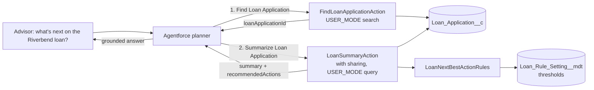

# Agentforce Loan Advisor Actions

[](https://github.com/khajamohsin0741-hash/agentforce-loan-advisor-actions/actions/workflows/ci.yml)
 

Apex actions that let an Agentforce agent answer "Where is this loan, and what should I do next?" for bank advisors. The agent's language model explains the answer, but the facts and the recommended next steps come from explicit, tested Apex rules, and every query respects the user's record access.

> **Portfolio project.** Independently written, clean-room demonstration using a synthetic `Loan_Application__c` object and fictitious data. It is not code from, or a copy of, any employer, client or vendor system (it does not use or imitate nCino objects). The thresholds are illustrative and are not lending policy.
>
> Built with AI-assisted development and reviewed by the author.

## Business problem

Advisors spend time opening several records to answer simple pipeline questions: what is missing, why an application is stalled, what happens next. An agent can answer in seconds, but in a regulated business the recommendations must be predictable, auditable and limited to data the advisor is allowed to see.

## What it demonstrates

| Area | Where |
| --- | --- |
| Two invocable Apex agent actions designed for the planner (clear labels and descriptions): find a loan, then summarize it | `FindLoanApplicationAction`, `LoanSummaryAction` |
| Thresholds owned by credit policy in Custom Metadata, not hard-coded | `Loan_Rule_Setting__mdt` (Default record), `LoanNextBestActionRules.loadSettings` |
| Safe search on user input: bind variables, escaped LIKE wildcards, result cap | `FindLoanApplicationAction` |
| Deterministic, unit-tested decision rules kept separate from the model | `LoanNextBestActionRules` |
| User-mode queries and `with sharing` so the agent cannot see more than the user | `LoanSummaryAction.summarize` |
| Bulk-safe action (one query for any number of requests) | `LoanSummaryAction.summarize` |
| Agent topic, instructions and guardrails | [`agent/loan-advisor-topic.md`](agent/loan-advisor-topic.md) |
| Tests run as a least-privilege user | `LoanSummaryActionTest` |

## Architecture



## Example output

For the synthetic Riverbend Logistics loan (stage Underwriting for 14 days, DTI 47.5%, credit band D, two documents missing):

```text
Summary: LA-00002 for Riverbend Logistics (synthetic): Commercial loan of $1,750,000.00. Stage: Underwriting for 14 days. Credit band D. Debt-to-income 47.5%. 2 document(s) outstanding.
Recommended actions:
1. Request missing documents: 2025 tax return, Rent roll.
2. Debt-to-income is 47.5%, above the 43% guideline. Review income documentation or discuss a lower amount or a co-borrower.
3. Credit band D. Route to a senior underwriter before discussing terms.
4. In underwriting for 14 days (target 10). Escalate to the underwriting manager.
```

## Tests

| Class | Tests | Covers |
| --- | --- | --- |
| `LoanNextBestActionRulesTest` | 8 | Every rule, boundary values, custom thresholds, deployed metadata defaults |
| `LoanSummaryActionTest` | 3 | Summary text and actions as a least-privilege user, not-found path, sparse records |
| `FindLoanApplicationActionTest` | 7 | Name and number search, multiple and capped matches, short input, no match, wildcard escaping |

CI parses all Apex with the Salesforce Code Analyzer (PMD) on every push, and runs the Apex tests in a scratch org when the `DEVHUB_SFDX_AUTH_URL` secret is configured.

## Setup

Requires an org with Agentforce enabled to configure the agent. The Apex and tests deploy to any scratch org.

```bash
sf org create scratch --definition-file config/project-scratch-def.json --alias loans --set-default
sf project deploy start
sf org assign permset --name Loan_Advisor_Agent
sf data import tree --plan data/sample-data-plan.json
sf apex run test --test-level RunLocalTests --code-coverage --result-format human --wait 20
```

Then follow [`agent/loan-advisor-topic.md`](agent/loan-advisor-topic.md) to add the topic and action to an agent. Imported sample loans have no `Stage_Entered__c`; set it on a record to see the stalled-underwriting rule.

## Responsible AI notes

* The action is read-only. Approving, pricing and declining stay with people and existing processes.
* The model is instructed to use only the action's outputs and to refuse decisions; test these refusals before any rollout.
* Outputs contain no account numbers or tax IDs.

## Limitations and next steps

* Add agent test cases in Agentforce Testing Center for the utterances listed in the topic file.
* Ground the summary in Data Cloud (payment history, deposits) for relationship-level recommendations.
* Add a write action (for example "Request missing documents" that creates a task) with user confirmation turned on.

## License

MIT. See [LICENSE](LICENSE).
